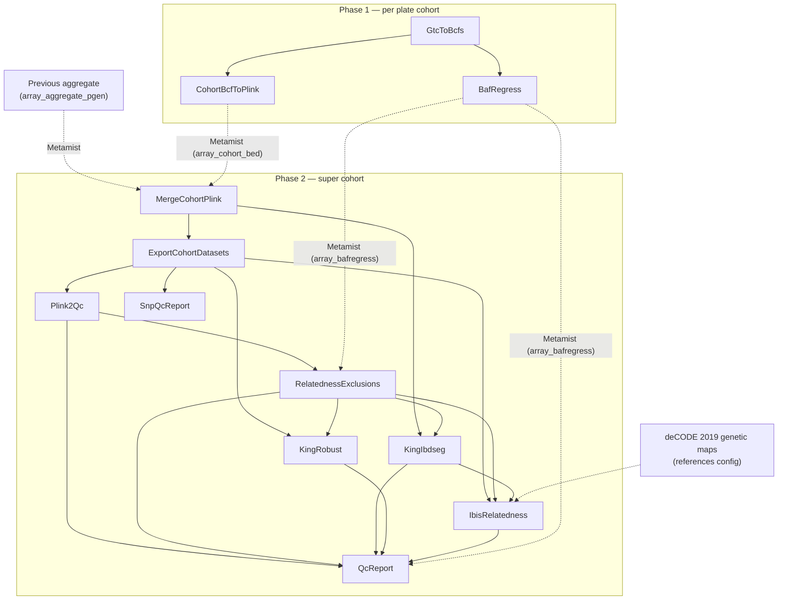

# Population Genomics Genotyping Pipeline

A `cpg-flow` pipeline to process genotyping microarray data, from raw Illumina GTC files to cohort-level PLINK and BCF datasets.

## Project Overview
This pipeline is designed to automate the conversion of dense, single-sample GTC files into analysis-ready, multi-sample datasets. It handles data conversion, quality control, and formatting, producing standard outputs suitable for downstream genetic analysis.

## Pipeline Architecture
The pipeline is composed of several sequential stages, orchestrated by `cpg-flow`. Each stage is responsible for a specific part of the data processing workflow.



The dashed edges are not stage dependencies: phase 2 discovers phase-1 outputs (and the
previous aggregate) by querying registered Metamist analyses, which is what lets the two
phases run as separate submissions with the manual super-cohort creation in between.

### Stages
- **GtcToBcfs**: Converts raw GTC files into two BCF formats: a "Heavy" BCF containing full intensity data and a "Light" BCF containing only genotype calls (GT) and quality scores (GQ). The job fails if the reheadered BCF's samples are not exactly the cohort's SG IDs (e.g. a manifest barcode that no longer matches the GTC sample names).
- **BafRegress**: Estimates sample contamination by analyzing B-Allele Frequencies (BAF) against a population reference. If no reference is provided, it will estimate AF from the cohort. Output is written to durable, version-independent storage and registered as an `array_bafregress` Metamist analysis (one per plate cohort).
- **CohortBcfToPlink**: Converts the Light BCF into PLINK 1.9 binary format (`.bed`, `.bim`, `.fam`), preparing it for merging. Output is written to durable, version-independent storage and registered as an `array_cohort_bed` Metamist analysis (one per plate cohort). See [Per-plate outputs are immutable](#per-plate-outputs-are-immutable).
- **MergeCohortPlink**: Merges PLINK files from multiple cohorts into a single, unified dataset. This stage also supports a "rolling aggregate" workflow, where new samples are added to a previously generated aggregate. See [Rolling aggregate & two-phase run](#rolling-aggregate--two-phase-run).
- **ExportCohortDatasets**: Converts the merged PLINK 1.9 dataset into PLINK2 (`.pgen`) format for long-term storage and analysis, and `.bcf` format in temporary storage for ancestry analysis.
- **Plink2Qc**: Performs a standard suite of quality control checks on the final PLINK2 dataset, including sample/variant missingness, allele frequency, HWE, heterozygosity, and kinship.
- **RelatednessExclusions**: Selects the samples left out of all three relatedness estimators below. A sample whose BAFRegress contamination estimate exceeds `contamination_max`, or whose `Plink2Qc`-derived per-sample missingness (`F_MISS`) exceeds `fmiss_max`, would otherwise generate thousands of spurious pairwise relationships and show up as a "relative" of every clean sample. BAFRegress outputs are resolved from Metamist (all registered `array_bafregress` analyses for the super cohort's membership), since `BafRegress` is a phase-1 stage. Writes an excluded-samples audit TSV (`IID`, `REASON`, `BAF_REGRESS`, `F_MISS`) and a plink2 `--remove` list (`#IID` header, one IID per line; header-only when nothing is excluded) that `KingIbdseg`, `KingRobust` and `IbisRelatedness` all remove, so they cannot disagree about who was left out. Registered as an `array_relatedness_exclusions` Metamist analysis. See [Relatedness estimators](#relatedness-estimators).
- **KingIbdseg**: Runs KING `--ibdseg --degree 3` against the merged PLINK 1.9 dataset to call pairwise IBD segments, after dropping the `RelatednessExclusions` samples with `plink2 --remove` (in the same pass that recodes the chromosomes to numeric codes, which KING requires). Emits autosomal `.seg` / `.segments.gz` and (when chrX SNPs are present) X-chr companions `X.seg` / `X.segments.gz`, and the captured KING log. Outputs land in long-term storage and are registered as an `array_relatedness_ibdseg` Metamist analysis.
- **KingRobust**: Runs `plink2 --make-king-table` on the aggregate PGEN, after removing the `RelatednessExclusions` samples, to write the KING-robust kinship (Manichaikul et al. 2010) of every pair at or above `kinship_min` (0.0442, the 3rd-degree lower bound). It runs on all variants, with no SNP-QC filtering, to match `KingIbdseg`, and on autosomes only. The table is gzipped (`.kin0.gz`, columns `IID1`, `IID2`, `NSNP`, `HETHET`, `IBS0`, `KINSHIP`) and registered as an `array_relatedness_king_robust` Metamist analysis.
- **IbisRelatedness**: Calls IBD segments with IBIS in genetic-map cM (deCODE 2019 sex-averaged map) and writes one row per related pair, with the kinship re-estimated from IBD runs of at least 5, 10 and 15 cM. KING `--ibdseg` can only filter segments by length in Mb, so a population with background relatedness gets "3rd-degree" KING pairs made of many short segments; the cM-length cutoffs tell recent relatedness (a few long segments) from background IBD. The autosomes and chromosome X run as separate IBIS jobs so X never enters the autosomal kinship; the `RelatednessExclusions` samples are dropped first; abutting IBIS segments are joined into runs before the cutoffs apply. The pairs table also carries the `KingIbdseg` InfType and kinship of each pair. Outputs: `ibis_relatedness_pairs.tsv.gz`, its `.json` sidecar (run parameters, input paths, the autosomal map length, counts), and the raw `ibis_autosomes.{seg.gz,coef.gz,log}` / `ibis_x.{seg.gz,coef.gz,log}` (all prefixed with the cohort ID). Registered as an `array_relatedness_ibis` Metamist analysis (the pairs table). See [Relatedness estimators](#relatedness-estimators) and `src/popgen_genotyping/jobs/ibis_relatedness_job.py` for what each job does and why.
- **SnpQcReport**: Per-SNP QC from the vendor cluster scores (EGT), the merged-set call rate and Hardy-Weinberg, applying the thresholds under `[popgen_genotyping.snp_qc_report.thresholds]`. Emits an audit TSV, an inclusion `.snplist` and a summary TSV; the released PGEN is not modified.
- **QcReport**: Merges `Plink2Qc`, `RelatednessExclusions`, the three relatedness estimators, and `BafRegress` outputs into a single per-sample CSV. Relatedness gets one column per estimator, each listing the sample's relatives at 3rd degree or closer as `REL_ID:KINSHIP:DEGREE` joined by `;`: `KING_IBDSEG_RELATIVES`, `KING_ROBUST_RELATIVES` and `IBIS_RELATIVES_GE5CM`. Samples excluded by `RelatednessExclusions` keep all their QC columns and are flagged `RELATEDNESS_EXCLUDED` (immediately after the three columns) with the exclusion reason (`contamination`, `missingness`, or both), rather than appearing to have thousands of relatives; the report fails if an excluded sample has a relative in any of the three columns.

### Relatedness estimators
Three estimators run on the same aggregate and the same sample set (everything except the `RelatednessExclusions` samples). They answer the same question differently, so the report keeps them side by side rather than merging them:

| Column | Source | KINSHIP | DEGREE |
|---|---|---|---|
| `KING_IBDSEG_RELATIVES` | KING `--ibdseg` `.seg` | `IBD1Seg/4 + IBD2Seg/2` | KING's `InfType`: `Dup/MZ`, `PO`, `FS`, `2nd`, `3rd` (a pair KING calls `4th` is dropped, with a note on stderr) |
| `KING_ROBUST_RELATIVES` | plink2 `.kin0` | the `KINSHIP` column | binned from the kinship: `Dup/MZ`, `1st`, `2nd`, `3rd` |
| `IBIS_RELATIVES_GE5CM` | IBIS pairs table | `IBIS_KINSHIP_GE5CM`: IBD runs of at least 5 cM, divided by the autosomal map length | `IBIS_DEGREE_GE5CM`: the same kinship bins as KING-robust |

All kinship values are rounded to four decimals. The kinship bins are those of Manichaikul et al. (2010), doi:10.1093/bioinformatics/btq559: kinship above 0.354 is `Dup/MZ`, 0.177 to 0.354 is `1st`, 0.0884 to 0.177 is `2nd`, 0.0442 to 0.0884 is `3rd`, and below 0.0442 is unrelated (a pair at a bound belongs to the closer-degree bin, except `Dup/MZ`, which is strictly above 0.354). The report lists only 3rd degree or closer, so a pair whose IBIS degree is `NA` (below the 3rd-degree bound, or a KING pair with no IBIS run of at least 5 cM) is not listed in `IBIS_RELATIVES_GE5CM`. An unrecognised degree label, or a missing column, fails the report.

The IBIS table's other cutoff columns (10 and 15 cM) and the autosomal/X segment statistics stay in `ibis_relatedness_pairs.tsv.gz`; they are not folded into the report.

### Per-plate outputs are immutable
`CohortBcfToPlink` and `BafRegress` write to durable, **version-independent** paths
(`<default_prefix>/<workflow>/<StageName>/<cohort_id>...`, with no `workflow.version`
segment). This decouples a plate's outputs from the pipeline version — a plate is processed
once and reused across runs, and phase 2 no longer has to run at the same `workflow.version`
before `tmp` is garbage-collected to find them.

Because there is no version segment, re-processing a plate **overwrites in place**. cpg-flow
skips a stage whose `expected_outputs` already exist, so the default is reuse (not silent
overwrite); an overwrite only happens if the outputs are deleted and regenerated — which
would change the bytes any prior aggregate was built from. **Treat per-plate outputs as
immutable once an aggregate references them.** To legitimately re-process a plate, prefer a
new cohort rather than overwriting an existing one.

### Rolling aggregate & two-phase run
Aggregate datasets are registered against a **super cohort** (previous aggregate SGs + new
plate SGs) so downstream consumers (e.g. the genomic atlas) can query array data by cohort.
cpg-flow cannot create or validate a cohort mid-run, so the pipeline runs in two phases:

1. **Phase 1** — run against the **new plate cohorts** (`input_cohorts=[new plates]`,
   `config_phase1.toml`). Produces and registers the per-plate `array_cohort_bed` and
   `array_bafregress` outputs.
2. **Create the super cohort** manually in Swagger (previous aggregate SGs ∪ new plate SGs).
3. **Phase 2** — run against the **super cohort** (`input_cohorts=[super]`,
   `config_phase2.toml`). Rolls the previous aggregate forward and merges only the new plates.

Every stage is a `CohortStage`, so nothing in the stage graph itself separates the phases: a
phase-2 submission would otherwise also run the per-plate stages on the super cohort, and a
phase-1 submission would run the aggregate stages once per plate. Each phase config therefore
pins `workflow.only_stages` to its phase's stages, and `run_workflow.py` refuses to submit when
`only_stages` is missing or mixes stages from both phases, or when a phase-2 run lists anything
other than exactly one cohort — a mismatched config fails at submission (in the driver job's
log), before any job is queued.

The previous aggregate is selected explicitly by **cohort ID** (`previous_aggregate_cohort_id`).
The new plates are **not listed** in phase-2 config — they are **derived**
(`NEW = super − previous aggregate`), and each new SG is resolved to its plate via the registered
`array_cohort_bed` analysis. The resolved plan (the contributing plate cohorts and their new-SG
counts) is printed to the driver log at submission: **confirm the plates match what you ran in
phase 1** before letting the run proceed. Use `scripts/list_aggregates.py` to pick the previous
aggregate cohort.

**Why derive the new plates instead of reusing the phase-1 plate list?** It might look simpler to
just carry the plate cohorts forward from phase 1, but deriving from the super cohort's membership
keeps that cohort the single source of truth and is robust to things a hand-carried list gets wrong:
- **Withdrawn / inactivated SGs** — an SG dropped since phase 1 is simply absent from the super
  cohort, so it is excluded automatically; a static plate list would silently re-include it.
- **Plates accumulated across several phase-1 runs** — phase 1 can run many times before a single
  phase-2 aggregation; you never have to collate every plate cohort ID from all those runs.
- **Custom / partial selection** — the super cohort can be any hand-picked SG set (a subset of a
  plate, or spanning plates); per-SG resolution handles this, whereas a plate list cannot.
- **No config drift** — the merged output cannot disagree with the cohort it is registered against;
  the post-`--keep` kept-sample-count assert plus the per-SG coverage check catch any plate
  never run through phase 1, failing loudly instead of producing a silently short aggregate.

The plan printout is what makes the derivation trustworthy: you get to eyeball the derived plate
set against your phase-1 runs rather than trusting it blind.

The final `plink --keep` trims the merged fileset to super-cohort membership (`merged ⊆ super`) and
asserts the kept-sample count equals the super cohort (`super ⊆ merged`) before the aggregate is
registered, so the released dataset cannot silently disagree with the cohort it registers against.

All phase-2 output filenames embed the super-cohort ID (e.g. `<cohort_id>_merged.bed`,
`<cohort_id>.pgen`). Every rolling aggregate gets a new super cohort, so successive
aggregates at the same `workflow.version` land on distinct paths — cpg-flow's skip-if-exists
can therefore never reuse a previous super cohort's merge for a new one. The filenames carry
no datestamp: paths are stable across days, so an interrupted phase 2 can be resumed (or a
single stage re-run with `only_stages`) later without recomputing everything upstream.

## Prerequisites
Before running the pipeline, ensure you have the following tools installed and configured:
- **`cpg-flow`**: The core workflow management system.
- **`analysis-runner`**: The command-line tool used to launch `cpg-flow` pipelines in the cloud.
- **Docker**: Required for running the local reproduction scripts.

## Configuration
The pipeline is configured using a TOML file, one per phase: start from
`src/popgen_genotyping/config_phase1.toml` (per-plate processing) or
`src/popgen_genotyping/config_phase2.toml` (aggregation against the super cohort).

### Key Parameters
- `[workflow]`:
    - `dataset`: The analysis dataset for the output.
    - `input_cohorts`: A list of cohort IDs to include in the run — the new plate cohorts in
      phase 1, exactly the super cohort in phase 2.
    - `only_stages`: The stages belonging to the phase being run. Mandatory; a submission
      that omits it or mixes stages from both phases is rejected (see
      [Rolling aggregate & two-phase run](#rolling-aggregate--two-phase-run)).
    - `sequencing_type`: Must be set to `genotypingarray` (the sequencing-group type; also
      the output-path subdirectory under the dataset bucket).
    - `driver_image`: The Docker image for the main `cpg-flow` driver. Use this repository's
      image (`popgen_genotyping:latest`, built by CI from `main`), which has `cpg-flow` and
      this package installed. Pass the same image to `analysis-runner --image` — this config
      key does not set the image the analysis-runner driver job itself runs in.
    - `bcftools_image`, `plink_image`, `king_image`: Docker images for the respective tools.
    - `ibis_image`, `plink2_cm_map_image` (phase 2, required): Docker images for `IbisRelatedness`. `plink2_cm_map_image` is the plink2 2.0 beta 1 build: the plink2 in `plink_image` (alpha 7) has no `--cm-map`, and that image's PLINK 1.9 `--cm-map` cannot read gzipped maps and silently leaves X at 0 cM. The two Python steps of `IbisRelatedness` (prepare-maps and summarise) run in `driver_image`.
- `[popgen_genotyping.references]`:
    - `fasta_ref_path`: Path to the human genome FASTA reference.
    - `bpm_manifest_path`: Path to the Illumina BPM manifest file.
    - `egt_cluster_path`: Path to the Illumina EGT cluster file.
    - `af_ref_path` (optional): Path to a VCF containing population allele frequencies for `BafRegress`.
- `[popgen_genotyping.merge_cohort_plink]`:
    - `previous_aggregate_cohort_id` (optional): The Metamist **cohort ID** of a previous aggregate to roll forward. Omit for a from-scratch (bootstrap) build. Use `scripts/list_aggregates.py` to list registered aggregate cohorts and pick one. See [Rolling aggregate & two-phase run](#rolling-aggregate--two-phase-run).
- `[popgen_genotyping.relatedness_exclusions]`:
    - `cpu`, `memory`, `storage`: job resources (optional, as for the other stages).
    - `contamination_max` (required): BAFRegress threshold above which a sample is dropped before every relatedness estimator (strictly greater than).
    - `fmiss_max` (required): Per-sample `F_MISS` (1 − call rate) threshold above which a sample is dropped before every relatedness estimator (strictly greater than). Same name and value as `snp_qc_report.thresholds.fmiss_max`, but a separate key: that one is applied per variant (keep if `<=`), this one per sample (exclude if `>`).
- `[popgen_genotyping.king_ibdseg]`: `cpu`, `memory`, `storage` for the recode and KING jobs (optional, as for the other stages).
- `[popgen_genotyping.king_robust]`:
    - `cpu`, `memory`, `storage`: job resources (optional, as for the other stages).
    - `kinship_min` (required): minimum KING-robust kinship of a pair written to the `.kin0` table (`plink2 --king-table-filter`). 0.0442 is the lower bound of 3rd degree.
- `[popgen_genotyping.ibis_relatedness]` (all required, no code defaults):
    - `genetic_map_reference_key`: references-config key of one chromosome's genetic map, with a `{chromosome}` placeholder filled with 1–22 and X, e.g. `genetic_maps_decode2019/sexavg_grch38_chr{chromosome}` (the references repo's `genetic_maps_decode2019` source, one file per chromosome under `gs://cpg-common-main/references/genetic_maps/decode2019`). The run fails at submission if a map does not exist.
    - `min_seg_cm`: IBIS `-min_l`, the shortest segment and the shortest run kept (cM).
    - `min_ibd2_cm`: IBIS `-min_l2`, the shortest IBD2 segment (cM). IBIS's 2 cM default gives parent-offspring pairs, who cannot be IBD2, a few false IBD2 calls.
    - `join_gap_cm`: segments of a pair on a chromosome with a gap below this (cM) are joined into one run.
    - `cutoffs_cm`: run lengths (cM) the kinship is re-estimated at; each at least `min_seg_cm`. `QcReport` reads the 5 cM columns, so 5 must be one of them.
    - `[...ibis_relatedness.plink2]`, `[...prepare_maps]`, `[...ibis_autosomes]`, `[...ibis_x]`, `[...summarise]`: `cpu`, `memory`, `storage` of each job. IBIS runs with `-t` equal to the `cpu` of its job.
- `[popgen_genotyping.snp_qc_report]`: `egt_info_bcf_reference_key` and `egt_info_bcf_index_reference_key` (references-config keys of the EGT INFO BCF and its index), and `[...snp_qc_report.thresholds]` `gentrain_min`, `cluster_sep_min`, `fmiss_max`, `hwe_p`, `hwe_k`, `hwe_midp`, `hwe_keep_fewhet`. All required, no code defaults. `fmiss_max` is per-variant (keep if `<=`); its per-sample counterpart is `relatedness_exclusions.fmiss_max`.

## Execution
To run the pipeline, use the `analysis-runner` command. You will need to specify the path to your configuration file, the output directory, and the script to execute.

From the repo root:

```bash
analysis-runner \
    --dataset <your-dataset> \
    --access-level <access-level> \
    --image australia-southeast1-docker.pkg.dev/cpg-common/images/popgen_genotyping:latest \
    --output-dir <output-directory> \
    --description 'popgen genotyping phase 1' \
    --config src/popgen_genotyping/config_phase1.toml \
    src/popgen_genotyping/run_workflow.py
```

`--image` is required: without it the analysis-runner driver job runs in the default
analysis-runner image, which has no `cpg-flow`, and the submission fails on import.

For phase 2, swap in `config_phase2.toml` (and a matching description). Note the phase
validation and the merge-plan printout run on the **driver job**, after `analysis-runner`
has already returned — check the driver batch's log for the plan (phase 2) or for the
ValueError if the config's `only_stages` was rejected.

Note for test runs: `Plink2Qc` requires at least 50 samples — plink2 refuses to impute
allele frequencies for `--het` / `--check-sex` below that. Production plates have 95
samples so any real aggregate clears it, but a small test super cohort must be sized
to 50+ SGs for the QC stages to run.

## Local Development & Testing
This repository includes scripts for local development and testing.

- **`test/scripts/reproduce_full_pipeline.py`**: A modular script that reproduces the entire pipeline workflow locally using Docker. This is useful for verifying changes and understanding the pipeline's behavior.
- **`test/scripts/reproduce_bafregress_production.py`**: A specialized test for `BafRegress` using a production-sized cohort (94 samples) and internal AF estimation.

To run the local tests, ensure Docker is running and execute the scripts directly. For example:
```bash
python3 test/scripts/reproduce_full_pipeline.py --samples 5 --snps 10000
```
